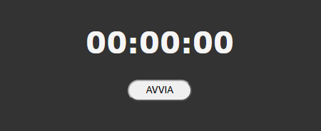

# Cronometro

## Descrizione

Un piccolo e semplice cronometro con un solo tasto "AVVIA" che mostra ore, minuti e secondi, senza i centesimi o millesimi. Creato per sperimentare con "setInterval()"
